***

<div align="center">

<!-- Animated Typing Header -->
<a href="https://git.io/typing-svg">
  
</a>

#   Self-Healing E-Commerce Scraper

**An Enterprise-Grade, Anti-Bot Resilient Price Intelligence Engine**

[](https://www.python.org/downloads/)
[](https://github.com/daijro/camoufox)
[](https://playwright.dev/)
[](https://streamlit.io/)
[](https://opensource.org/licenses/MIT)

<p align="center">
  <i>Scrape Amazon, Flipkart, and Alibaba without getting blocked. If the  site changes, the scraper adapts.</i>
</p>

</div>

---

##  Table of Contents
1. [The Philosophy](#-the-philosophy)
2. [Architecture Mindmap](#-architecture-mindmap)
3. [Execution Flowchart](#-execution-flowchart)
4. [The 2 Core Pillars of Resilience](#-the-2-core-pillars-of-resilience)
5. [The 6-Tier Extraction Cascade](#-the-6-tier-extraction-cascade)
6. [Installation Guide](#-installation-guide)
7. [Usage Guide](#-usage-guide)
8. [Project Structure](#-project-structure)
9. [Troubleshooting](#-troubleshooting)

---

##  The Philosophy

Modern e-commerce sites are no longer just HTML documents; they are heavily fortified applications protected by Cloudflare, Akamai, and custom behavioral analysis engines. 

A traditional scraper uses a single CSS selector. When the site redesigns, it breaks.
**This scraper is built on the principle of Cost-Per-Successful-Payload.** It doesn't waste RAM by launching a heavy browser for every request. It uses a **Hybrid Architecture**: lightning-fast HTTP requests for easy sites, and deep-stealth browser rendering *only* when absolutely necessary.

---

##  Architecture Mindmap

```text
Self-Healing Scraper Architecture
│
├──  1. Fetching Layer (Hybrid Cascade)
│   ├──  Fast Path: curl_cffi (TLS/JA3 Impersonation) 
│   │   └── Bypasses basic blocks, takes ~200ms, uses 0% Browser RAM.
│   ├──  Heavy Path: Camoufox (Firefox Fork)
│   │   └── C++ level fingerprint spoofing for heavily guarded sites (Amazon).
│   └──  CDP Fallback: Chrome DevTools Protocol
│       └── Attaches to a real, manually logged-in Chrome window if all else fails.
│
├──  2. Anti-Bot Layer
│   ├── Warm Sessions: Reuses your real Amazon cookies (data/sessions/).
│   ├── Proxy Manager: Rotates IPs seamlessly when bans are detected.
│   └── Stealth Headers: Mimics real OS, browser, and language settings.
│
├──  3. Extraction Cascade (6 Tiers)
│   ├── Tier 1: JSON-LD (Schema.org structured data)
│   ├── Tier 2: Embedded JSON (Next.js / Shopify __NEXT_DATA__)
│   ├── Tier 3: CSS Selectors (Heals itself using historical success)
│   ├── Tier 4: Regex Fallback (Pairs nearest links and prices)
│   ├── Tier 5: Fuzzy Matcher (Scans raw DOM for currency symbols)
│   └── Tier 6: LLM Healer (Google Gemini / Qwen3.6 as last resort)
│
├──  4. Validation Layer
│   ├── Garbage Filter: Drops menus, filters, UI text, and buttons.
│   └── Relevance Scorer: Multi-factor scoring (Brand, Category, Fuzzy match).
│
└──  5. Output Layer
    ├── SQLite Database: Persistent storage for historical analytics.
    ├── CSV Exporter: Timestamped, INR normalized data.
    └── Streamlit Dashboard: Live Plotly charts and KPI tracking.
```

---

##  Execution Flowchart

```mermaid
sequenceDiagram
    autonumber
    actor User
    participant UI as Interactive CLI
    participant AE as Anti-Ban Engine
    participant Engine as Scraper Engine
    participant Validator
    participant DB as SQLite/CSV

    User->>UI: Enters search term (e.g., "Samsung S24")
    UI->>UI: Check for Amazon Warm Cookies
    alt Cookies Missing
        UI-->>User: Warning: Run warm_amazon.py first!
    end
    
    loop For each Site (Amazon, Flipkart, etc.)
        UI->>AE: Fetch URL
        
        rect rgb(30, 30, 30)
            Note over AE: Phase 2: Hybrid Fetching
            AE->>AE: Try Fast TLS Fetch (curl_cffi)
            alt TLS Blocked (e.g., Amazon)
                AE->>AE: Launch Stealth Browser (Camoufox)
                AE->>AE: Inject Warm Cookies
            end
        end
        
        AE-->>Engine: Return HTML
        
        rect rgb(20, 40, 60)
            Note over Engine: Phase 1: Self-Healing Cascade
            Engine->>Engine: Try JSON-LD
            Engine->>Engine: Try Embedded JSON
            Engine->>Engine: Try CSS Selectors
            Engine->>Engine: Try Regex
            Engine->>Engine: Try Fuzzy Match
            Engine->>Engine: Try LLM (Gemini)
        end
        
        Engine-->>Validator: Raw Products
        Validator->>Validator: Score Relevance (0-100)
        Validator->>Validator: Drop Junk/Accessories
        Validator-->>DB: Save Valid Products
    end
    
    DB-->>UI: Generate CSV & Open Menu
    UI-->>User: Success! View data or read instructions.
```



---

##  The 2 Core Pillars of Resilience

<details>
<summary><b> Pillar 1: Hybrid Fetching Architecture (Phase 2)</b></summary>
<br>

Launching a full Firefox browser for every single request is slow and eats gigabytes of RAM. We use a cost-optimized hybrid approach:
*   **The Fast Path:** The scraper first attempts a standard HTTP request using `curl_cffi`. This library spoofs the TLS fingerprint (JA3/JA4) of a real Chrome browser. It fetches static sites (like BooksToScrape) in milliseconds.
*   **The Heavy Path:** If the fast path fails (returns a 403) OR the site requires JavaScript (like Amazon), the scraper falls back to **Camoufox**, a heavily modified Firefox fork that spoofs fingerprints at the C++ engine level. 
</details>

<details>
<summary><b> Pillar 2: Warm Session Management (Phase 1)</b></summary>
<br>

Amazon's biggest defense is analyzing session history. A fresh browser with zero cookies is instantly flagged as a bot. 
*   We include a `warm_amazon.py` script. You run this once, log into Amazon manually, and the script saves your valid cookies to `data/sessions/amazon_cookies.json`.
*   Every future scrape uses these warm cookies, making the scraper look exactly like you browsing normally.
*   If Chrome is open with remote debugging (`--remote-debugging-port=9222`), the scraper will actually attach to your real browser via CDP (Chrome DevTools Protocol) for 100% undetectable extraction.
</details>

---

##  The 6-Tier Extraction Cascade

When the HTML is fetched, the engine doesn't just rely on one method. It tries 6 different strategies in order, stopping as soon as it succeeds:

| Tier | Strategy | How it works |
| :--- | :--- | :--- |
| **1** | **JSON-LD** | Scans for `<script type="application/ld+json">`. This is the most resilient method. |
| **2** | **Embedded JSON** | Scans for Next.js (`__NEXT_DATA__`) or Shopify blobs. Extracts raw JSON trees. |
| **3** | **CSS Selectors** | Uses BeautifulSoup. Prioritizes selectors that worked in previous runs (self-healing memory). |
| **4** | **Regex Fallback** | Scans raw HTML using regex to pair product names with their closest price tag. |
| **5** | **Fuzzy Matcher** | Scans the raw text for currency symbols (`₹`, `$`) and scores nearby text blocks based on length and keywords. |
| **6** | **LLM Healer** | Sends cleaned HTML to Google Gemini or Qwen AI to extract the data semantically. |

---

##  Installation Guide

> [!WARNING]
> **CRITICAL REQUIREMENT:** This project requires **Python 3.12 or 3.13**. Using Python 3.15+ will cause compilation errors with C++ dependencies (`zstandard`, `pyyaml`).

### 1. Setup Environment
```bash
# Clone the repository
git clone https://github.com/uyg7x/Self-Healing-Web-Scraper.git
cd Self-Healing-Web-Scraper

# Create a Python 3.12 virtual environment
py -3.12 -m venv .venv312

# Activate the environment (Windows)
.\.venv312\Scripts\activate

# Activate the environment (Mac/Linux)
source .venv312/bin/activate
```

### 2. Install Dependencies
```bash
pip install --upgrade pip
pip install -r requirements.txt
```

### 3. Install the Stealth Browser (Camoufox)
```bash
python -m camoufox fetch
```
*(This downloads a ~1.3GB custom Firefox binary. You only need to do this once).*

---

##  Usage Guide

### Step 1: Warm Up Amazon (Crucial)
Because Amazon blocks automated logins, you must warm up the session first:
```bash
python warm_amazon.py
```
*   A browser window will open.
*   Log into Amazon normally. Solve any CAPTCHAs.
*   Come back to the terminal and press **Enter**. Your cookies are saved!

### Step 2: Run the Scraper
```bash
python main.py
```
*   Enter your search term (e.g., `macbook m4`).
*   Watch the interactive UI as it tries the Fast TLS path, falls back to the Stealth Browser for Amazon, and processes the data.
*   Use the post-scrape menu to view products directly in the terminal or view the saved CSV path.

### Step 3: Launch the Analytics Dashboard
View historical data, price trends, and self-healing metrics:
```bash
streamlit run dashboard.py
```

---

##  Project Structure

```text
Self-Healing-Web-Scraper/
├── main.py                # Interactive CLI, UI, and CSV generation
├── antiban_engine.py      # Routes between Fast TLS and Stealth Browser
├── scraper_engine.py      # The 6-tier extraction cascade
├── stealth_fetcher.py     # Camoufox launcher
├── session_manager.py     # Warm cookie management
├── validators.py          # Relevance scoring and garbage filtering
├── llm_healer.py          # Gemini AI fallback
├── qwen_fallback.py       # Qwen AI fallback
├── config.py              # Site configs, URL templates, CSS selectors
├── dashboard.py           # Streamlit frontend
├── warm_amazon.py         # Amazon login script
├── database.py            # SQLite storage
├── proxy_manager.py       # Proxy rotation logic
└── data/                  # Generated CSVs, SQLite DB, and session cookies
```

---

##  Troubleshooting

<details>
<summary><b>Amazon says "No products found" or gives a CAPTCHA</b></summary>
<br>
1. Your cookies likely expired. Run <code>python warm_amazon.py</code> again to refresh them.
2. Amazon flagged your IP. Add residential proxies to <code>proxy_manager.py</code>.
3. Open a real Chrome window with <code>chrome.exe --remote-debugging-port=9222</code>, log into Amazon, and let the scraper attach to it via CDP.
</details>

<details>
<summary><b>ModuleNotFoundError: No module named 'bs4'</b></summary>
<br>
You forgot to activate your virtual environment. Run <code>.\.venv312\Scripts\activate</code> before running the script.
</details>

<details>
<summary><b>IndentationError in Python</b></summary>
<br>
Python is extremely strict about spaces. If you edited a file, ensure all indentation uses exactly 4 spaces, not tabs. Copy the raw source from this repository if you get stuck.
</details>

---

<div align="center">

**Built with resilience in mind. If the site changes, the scraper adapts.**

If this project saved you time, a ⭐ on the repo is always appreciated!

Need Help or Custom Data?

    Don't want to run the code yourself? I can run it for you and deliver a clean CSV/Excel file.

    Need to scrape a specific website that isn't supported? I can add custom selectors for you.

    Facing installation issues? I offer 1-on-1 setup support.
    Contact me: Dharmendrakushwaha1137@gmail.com   | https://www.upwork.com/freelancers/~011dabd983b843d312 

</div>

##  Roadmap (v2.0)

We are constantly improving the architecture to make scraping even more resilient and accessible. 

- [x] **v1.1.1:** 6-Tier Extraction Cascade + AI Fallbacks (Current)
- [ ] **v1.2.0:** Cloud Data Export (AWS S3 & Snowflake integration)
- [ ] **v1.3.0:** FastAPI REST Endpoint (Trigger scrapes via HTTP requests)
- [ ] **v2.0.0 (Upcoming):** **Polyglot Orchestrator Architecture**
  - *Building a Java-based CLI wrapper that manages Docker containers. This will allow non-technical users to run the scraper without installing Python or dealing with C++ build errors. Docker will dynamically provision the isolated Python engine on demand.*
```
