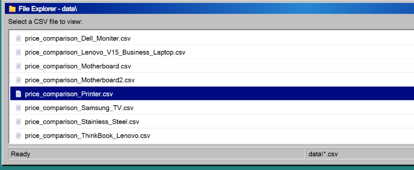
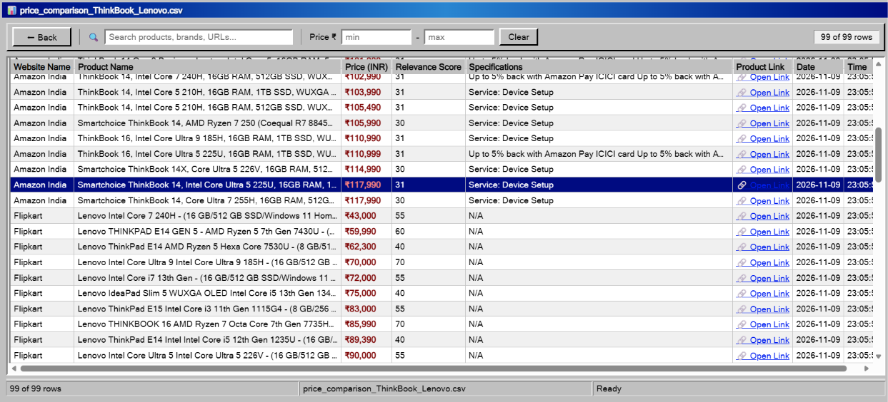
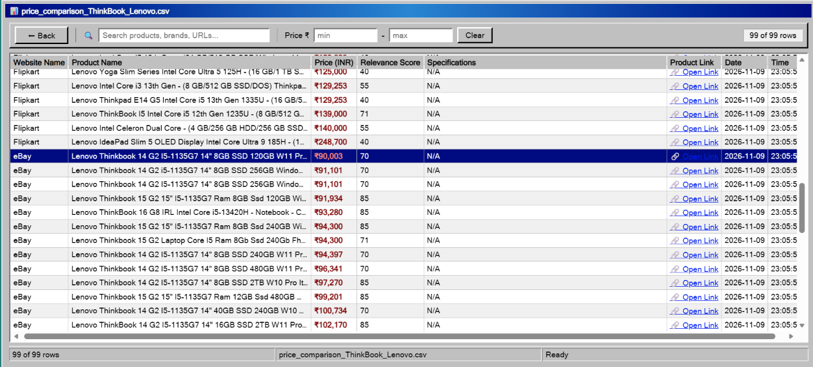
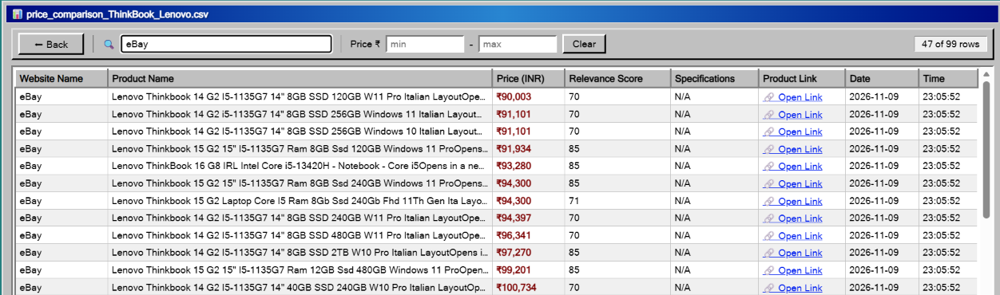
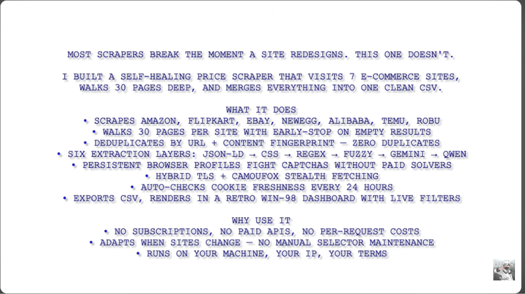
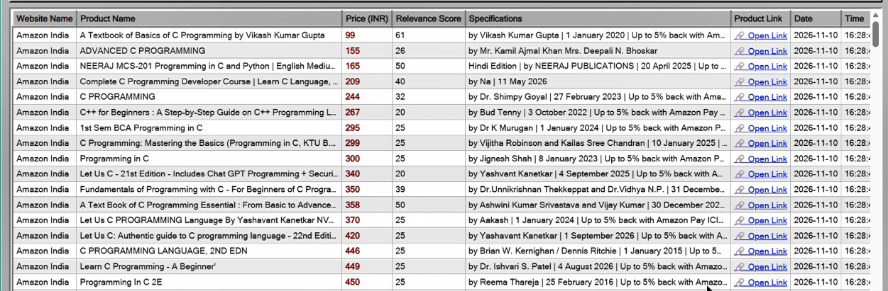
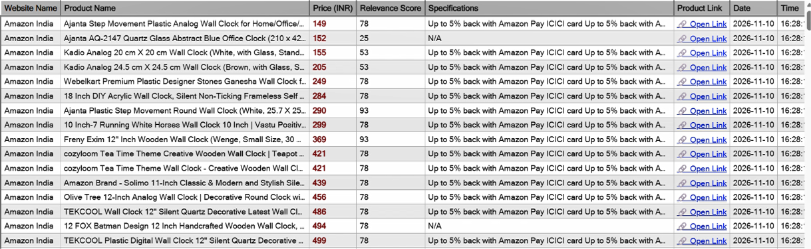

<div align="center">

<!-- ========================================================= -->
<!-- 1. SCRAPER NAME & HERO HEADER                             -->
<!-- ========================================================= -->


#   Scraper
### ** Scrape With Tea**

[](https://www.python.org/)
[](https://github.com/daijro/camoufox)
[](https://playwright.dev/)
[](https://streamlit.io/)

[](LICENSE)

<p align="center">
  <b>Scrape Amazon, Flipkart, Alibaba, and modern e-commerce platforms without getting blocked.</b><br>
  When websites change their layout, this scraper doesn't crash — <b>it heals itself automatically.</b><br>
  <b>No subscriptions. No hidden costs. Not a single rupee or dollar to pay. Just scrape and run.</b>
</p>

</div>

---

##  Table of Contents

- [ The Self-Healing Scraper Module](#️-the-self-healing-scraper-module)
- [ Instant Output Preview](#-instant-output-preview-4-views-in-1-unified-frame)
- [ Detailed Overview](#-detailed-overview-what-is-this-scraper--what-can-it-do)
- [ The Problem](#-the-problem-why-do-99-of-web-scrapers-fail)
- [ The Answer & Deep Research](#-the-answer-months-of-research--how-we-made-it-successful)
- [ Watch the Scraper in Action](#-watch-the-scraper-in-action-live-video-demo)
- [ Complete Features](#-complete-features-of-the-scraper-in-full-detail)
- [ What Makes It Different](#-what-makes-our-scraper-different-from-others-why-use-this-only)
- [ Real-World Tester Outputs](#-real-world-tester-search-outputs-verified-across-multiple-queries)
- [ Requirements](#-requirements)
- [ Project Structure](#️-project-structure)
- [ Installation Guide](#️-complete-step-by-step-installation-guide-windows-macos--linux)
- [ Common Errors & Fixes](#-common-errors--instant-solutions-troubleshooting-guide)
- [ FAQ](#-faq)
- [ Roadmap](#️-roadmap)
- [ Contributing](#-contributing)
- [ License](#-license)
- [ Contact](#-contact-the-creator-directly)
- [ Star & Share](#-loved-this-project-please-star--share-it-with-everyone)

---

##  The Scraper Module

<div align="center">
  <p><em>We build That If  its brea it will Reuild it self</em></p>
</div>

---

##  Instant Output Preview (4 Views in 1 Unified Frame)

<table>
  <tr>
    <td align="center" width="50%">
      
      <br /><b>1. Clean and Sorted File</b>
    </td>
    <td align="center" width="50%">
      
      <br /><b>2. Price Intelligence Dashboard</b>
    </td>
  </tr>
  <tr>
    <td align="center" width="50%">
      
      <br /><b>3. Clean, Zero-Junk INR Normalized CSV Data</b>
    </td>
    <td align="center" width="50%">
      
      <br /><b>4. Multi-Site Price Comparison & Relevance Scoring</b>
    </td>
  </tr>
</table>

---

##  Detailed Overview: What Is This Scraper & What Can It Do?

The ** Scraper** is an enterprise-grade, open-source e-commerce data extraction and price comparison system built for **both everyday users and developers**.

Whether you want to compare product prices across **Amazon, Flipkart, and Alibaba**, track competitor pricing over time, trigger automated price-drop alerts, or build clean datasets for machine learning — this tool handles the entire pipeline from start to finish.

### What It Can Do For You Out-of-the-Box:
- **Scrape Heavily Fortified E-Commerce Sites:** Bypasses Cloudflare, Akamai, and Amazon bot detection using a hybrid combination of fast TLS fingerprint impersonation (`curl_cffi`), a C++-modified stealth browser (`Camoufox`), warm cookie injection (`warm_amazon.py`), and live Chrome DevTools Protocol (`CDP`) attachment.
- **Heal Itself When Websites Change:** Instead of relying on a single fragile CSS selector that breaks whenever a website updates its design, the engine cascades through **6 distinct extraction tiers** (JSON-LD, Embedded State JSON, Adaptive CSS with Memory, Proximity Regex, Fuzzy DOM Heuristics, and Google Gemini / Qwen AI).
- **Deliver 100% Clean, Verified Data:** Automatically removes website UI garbage (menus, buttons, banners) and filters out unrelated cheap accessories (like phone cases when you searched for a smartphone) using a **0–100 Multi-Factor Relevance Scorer**.
- **Store, Export & Visualize Automatically:** Saves every run into a persistent **SQLite Database** for historical tracking, exports ready-to-use **timestamped CSV spreadsheets** normalized to INR (`₹`), and launches an interactive **Streamlit + Plotly Dashboard** with one command.
- **100% Free Forever ($0.00):** You do not have to pay for expensive monthly scraping APIs or SaaS subscriptions. Everything runs locally on your machine. **Just clone, type your product name, scrape, and run.**

---

##  The Problem: Why Do 99% of Web Scrapers Fail?

Before building this project, we tested dozens of open-source scrapers and standard Python approaches (`requests`, `BeautifulSoup`, standard `Selenium`/`Playwright`). Every single one failed in real-world production due to **four massive roadblocks**:

1. **Aggressive Anti-Bot Walls & Instant Bans:** Modern e-commerce websites are no longer simple HTML pages — they are heavily guarded web applications protected by **Cloudflare, Akamai, DataDome, and custom behavioral trackers**. Standard Python requests leak their TLS handshake signature immediately, resulting in `403 Forbidden` errors, endless CAPTCHA puzzles, or spoofed ₹0 dummy pages.
2. **Constant Website Layout Redesigns (Selector Rot):** A traditional scraper relies on hardcoded CSS or XPath selectors (for example, `.a-price-whole` or `div._30jeq3`). E-commerce engineering teams frequently A/B test layouts and rename CSS classes. The moment a class name changes, a traditional scraper crashes completely or returns empty data.
3. **Massive RAM Consumption & Slow Speeds:** To bypass JavaScript protections, developers often spin up headless Chrome/Selenium browsers for every single URL. Scraping 20–30 pages this way consumes gigabytes of RAM, freezes your computer, and takes minutes per query.
4. **Polluted, Inaccurate "Garbage" Output:** When you search for *"Samsung S24"* on an e-commerce store, the search page also displays ₹199 silicone back covers, screen guards, charging adapters, and sponsored unrelated items. Standard scrapers blindly dump all of this into your spreadsheet, ruining your price averages and analytics.

---

##  The Answer: Months of Research & How We Made It Successful

To solve these four problems permanently, we spent months researching **network-level TLS fingerprinting, browser engine C++ internals, session trust scoring, and heuristic DOM parsing**.

Instead of building "just another script," we engineered a **5-Layer Resilient Architecture** based on **Cost-Per-Successful-Payload**.

> **Note:** The **5 layers** describe the overall system (`Fetch → Anti-Bot → Extract → Validate → Persist`). The **6 tiers** describe only the extraction layer's self-healing cascade.

### Breakthrough 1: Researching How Anti-Bot Engines Detect Scrapers
During our research, we discovered that websites block scrapers at **three different checkpoints**:
- **Checkpoint A (The Network Handshake):** Before a server even looks at your `User-Agent` header, it checks your **TLS JA3/JA4 fingerprint**. Python's `requests` and `urllib` scream "I am a Python bot!" at the network level.
  - *Our Solution:* We integrated **`curl_cffi`** as our **Fast Path**. It impersonates the exact TLS/JA3/JA4 handshake and HTTP/2 framing of a real Google Chrome browser — fetching pages in **~200ms with 0% browser RAM**.
- **Checkpoint B (Browser JavaScript Fingerprinting):** For heavily fortified targets like Amazon, the site runs JavaScript to inspect `navigator.webdriver`, Canvas rendering, WebGL shaders, and AudioContext fingerprints.
  - *Our Solution:* When the Fast Path encounters a block, our engine seamlessly escalates to **`Camoufox`** — a Firefox fork patched at the **C++ engine level** — or attaches directly to your real open Chrome browser via **Chrome DevTools Protocol (`cdp_scraper.py`)**.
- **Checkpoint C (Cookie & Session Trust History):** Amazon flags brand-new browser profiles that have zero browsing history.
  - *Our Solution:* We engineered **`warm_amazon.py`** and **`session_manager.py`**. You warm up a real session once, and the scraper injects your authentic, trusted cookies (`data/sessions/`) into every future request.

### Breakthrough 2: Researching How to Make a Scraper That Never Breaks
We asked a fundamental question: *"When a website changes its CSS class names, how does a human still know what the product title and price are?"*
A human looks at visual proximity, currency symbols (`₹`, `$`), text length, and page structure. Meanwhile, search engines read hidden `JSON-LD` schemas, and modern frameworks like Next.js store raw product catalogs in hidden JSON state blobs (`__NEXT_DATA__`).

By combining **all six methods into a single self-healing cascade**, we achieved near-100% extraction continuity:

```text
 Scraper Architecture
│
├── 1. Fetching Layer (Hybrid Cost-Optimized Cascade)
│   ├── Fast Path: curl_cffi (TLS/JA3/JA4 Chrome Impersonation -> ~200ms, 0% Browser RAM)
│   ├── Heavy Path: Camoufox (C++ Level Fingerprint Spoofing for Amazon/Guarded Sites)
│   └── CDP Fallback: Chrome DevTools Protocol (Attaches to your real logged-in Chrome)
│
├── 2. Anti-Bot & Trust Layer
│   ├── Warm Sessions: Injects real authenticated cookies (data/sessions/)
│   ├── Proxy Manager: Automatic IP rotation & ban recovery
│   └── Stealth Headers: OS, viewport, language, and jitter synchronization
│
├── 3. Extraction Cascade (The 6-Tier Self-Healing Engine)
│   ├── Tier 1: JSON-LD (<script type="application/ld+json"> structured schema)
│   ├── Tier 2: Embedded JSON (Next.js __NEXT_DATA__ & Shopify hydration state trees)
│   ├── Tier 3: Adaptive CSS Selectors (Self-heals using historical success memory)
│   ├── Tier 4: Regex Fallback (Proximity pairing of product anchors and price patterns)
│   ├── Tier 5: Fuzzy DOM Matcher (Scans raw DOM for currency symbols & scores blocks)
│   └── Tier 6: AI LLM Healer (Google Gemini & CoE Qwen AI semantic DOM extraction)
│
├── 4. Validation & Accuracy Layer
│   ├── Garbage Filter: Strips navigation menus, footer links, filters, and UI text
│   └── Relevance Scorer: Multi-factor 0–100 scoring (Brand, Category, Accessory filter)
│
└── 5. Persistence & Output Layer
    ├── SQLite Database: Historical price tracking & analytics storage
    ├── CSV Exporter: Timestamped, clean, INR-normalized spreadsheets
    └── Streamlit Dashboard: Interactive Plotly charts, KPIs, and deal comparison
```

### Complete Execution Flowchart

```mermaid
sequenceDiagram
    autonumber
    actor User
    participant UI as Interactive CLI
    participant AE as Anti-Ban Engine
    participant Engine as 6-Tier Scraper Engine
    participant Validator as Relevance & Garbage Filter
    participant DB as SQLite / CSV / Dashboard

    User->>UI: Enters search term (e.g., "Samsung S24")
    UI->>UI: Check for Warm Session Cookies
    alt Cookies Missing
        UI-->>User: Notice: Run warm_amazon.py first for max stealth!
    end
    loop For each Site (Amazon, Flipkart, Alibaba, etc.)
        UI->>AE: Request Target URL
        rect rgb(30, 45, 35)
        Note over AE: Phase 1: Hybrid Stealth Fetching
        AE->>AE: Try Fast TLS Fetch (curl_cffi ~200ms)
        alt TLS Blocked / JS Challenge (e.g., Amazon)
            AE->>AE: Launch Stealth Browser (Camoufox / CDP)
            AE->>AE: Inject Warm Cookies & Human Jitter
        end
        end
        AE-->>Engine: Return Raw HTML
        rect rgb(20, 40, 60)
        Note over Engine: Phase 2: 6-Tier Self-Healing Cascade
        Engine->>Engine: Tier 1: Try JSON-LD
        Engine->>Engine: Tier 2: Try Embedded JSON
        Engine->>Engine: Tier 3: Try Adaptive CSS Selectors
        Engine->>Engine: Tier 4: Try Proximity Regex
        Engine->>Engine: Tier 5: Try Fuzzy Currency Match
        Engine->>Engine: Tier 6: Try LLM Healer (Gemini / Qwen)
        end
        Engine-->>Validator: Raw Candidate Products
        Validator->>Validator: Score Relevance (0-100) & Filter Accessories/Junk
        Validator-->>DB: Save Verified Products
    end
    DB-->>UI: Export Clean CSV & Update Dashboard
    UI-->>User: Success! View data or launch visual dashboard.
```



---

##  Watch the Scraper in Action (Live Video Demo)

<div align="center">


<a href="https://www.youtube.com/watch?v=OC25hvYn0W4"></a>


<p><em> Above: Watch the scraper take a search query, bypass anti-bot protections, execute the self-healing extraction cascade, filter out junk accessories, and populate the live dashboard.</em></p>

</div>

---

##  Complete Features of the Scraper (In Full Detail)

Every module in this repository was engineered with a specific role to make scraping effortless, fast, and unbreakable:

1. **Hybrid Stealth Fetching Engine (`stealth_fetcher.py` & `antiban_engine.py`):**
   - **What it does:** Automatically selects the fastest, lowest-RAM method to fetch a web page without getting blocked.
   - **How it helps you:** Uses `curl_cffi` to impersonate Chrome's TLS/JA3 fingerprint for instant ~200ms responses, and only launches the `Camoufox` C++ stealth browser when a site challenges the request — saving up to 80% of system RAM.
2. **6-Tier Self-Healing Extraction Engine (`self_healing.py`):**
   - **What it does:** Cascades through 6 progressively smarter extraction methods (`JSON-LD` ➔ `Embedded JSON` ➔ `Self-Healing CSS` ➔ `Regex Fallback` ➔ `Fuzzy Currency Matcher` ➔ `AI LLM Healer`).
   - **How it helps you:** If Amazon or Flipkart redesigns their HTML tomorrow, your scraper won't crash. It automatically falls back to the next working tier and remembers successful selectors for future runs.
3. **Dual AI Semantic Healers (`llm_healer.py` & `qwen_fallback.py`):**
   - **What it does:** Strips noisy scripts/styles from raw HTML and sends a compact DOM structure to **Google Gemini** or **CoE Qwen AI** when all heuristic tiers fail.
   - **How it helps you:** Acts as an ultimate safety net that reads even the most obfuscated web pages like a human analyst.
4. **Warm Session & Cookie Manager (`warm_amazon.py` & `session_manager.py`):**
   - **What it does:** Opens a real browser window once so you can establish a trusted session, saving your cookies into `data/sessions/amazon_cookies.json`.
   - **How it helps you:** Eliminates "Robot Check" CAPTCHAs on Amazon by making every automated scrape look like a returning human shopper.
5. **Real Chrome CDP Attachment (`cdp_scraper.py`):**
   - **What it does:** Connects directly to your personal Google Chrome browser over the Chrome DevTools Protocol (`--remote-debugging-port=9222`).
   - **How it helps you:** Provides undetectable extraction on sites with extreme enterprise bot protection because traffic originates from your literal desktop browser.
6. **Multi-Factor Relevance Scorer & Garbage Filter (`validators.py` & `schemas.py`):**
   - **What it does:** Scores every scraped product from **0 to 100** based on keyword alignment, brand matching, and price sanity while stripping out UI noise and accessories.
   - **How it helps you:** Ensures that when you search for a laptop or phone, your dataset only contains actual laptops or phones — never ₹299 cables, pouches, or navigation links.
7. **Automated Price Alerts & Background Scheduler (`scheduler.py` & `alerts.py`):**
   - **What it does:** Runs scheduled scraping jobs in the background at intervals you define and monitors for price drops.
   - **How it helps you:** Lets you track products hands-free and get notified the moment a deal hits your target price.
8. **SQLite Database, Clean CSV Exporter & Streamlit Dashboard (`database.py` & `dashboard.py`):**
   - **What it does:** Normalizes all prices to INR (`₹`), stores historical records in SQLite, generates clean timestamped CSVs, and powers a full Streamlit + Plotly web app.
   - **How it helps you:** Gives you instant visual charts, lowest-price KPI cards, and downloadable spreadsheets without writing a single line of data-cleaning code.

---

##  What Makes Our Scraper Different From Others? (Why Use This Only?)

Here is the exact breakdown of why **Self-Healing Web Scraper** stands apart in accuracy, reliability, and cost:

| Comparison Factor | Standard GitHub Scrapers (`BS4` / `Selenium`) | Paid Cloud Scrapers (`ScraperAPI` / `ZenRows` / `BrightData`) | 🛡️ **Our Self-Healing Web Scraper** |
| :--- | :---: | :---: | :---: |
| **Total Cost** | Free (but breaks constantly) | ❌ **$49 to $299+ per month** | ✅ **100% Free Forever ($0.00)** |
| **Survival Rate When HTML Changes** | ❌ **0%** (Crashes on selector change) | ❌ **0%** (Returns raw HTML only) | ✅ **~99.9% (6-Tier Self-Healing Cascade)** |
| **Anti-Bot & CAPTCHA Bypass** | ❌ Blocked after 2–3 requests | ⚠️ Charges 10x–25x "Premium Credits" | ✅ **Built-in TLS Spoofing + Camoufox C++ + CDP** |
| **Data Accuracy & Accessory Filtering** | ❌ Dumps cases, cables & UI garbage | ❌ No filtering or validation | ✅ **0–100 Relevance Scorer + Pydantic Validation** |
| **Memory & Speed Optimization** | ❌ Opens heavy browser on every page | ⚠️ High network latency | ✅ **Hybrid (~200ms Fast Path + Smart Escalation)** |
| **Offline Capability** | ✅ Yes | ❌ Requires paid cloud API key | ✅ **Tiers 1–5 run 100% locally with zero API keys** |
| **Visual Dashboard & Price Alerts** | ❌ Terminal text only | ❌ Raw JSON/HTML response only | ✅ **Full Streamlit Dashboard + SQLite + Alerts** |

### Why Our Accuracy Beats Every Other Scraper:
1. **Context-Aware Accessory Rejection:** Other scrapers match keywords blindly. Our `validators.py` engine understands the difference between a **primary product** (*"Apple iPhone 16 128GB"*) and an **accessory** (*"Back Cover Case for Apple iPhone 16"*), preventing cheap accessories from corrupting your minimum and average price metrics.
2. **Cross-Tier Verification:** Even if a website hides its price inside a JavaScript hydration object (`__NEXT_DATA__`) or changes its DOM layout mid-scrape, the cascade validates the extracted payload against strict **Pydantic schemas (`schemas.py`)** before accepting it. If a tier extracts incomplete data, the engine automatically drops down to the next tier until a complete, valid product record is recovered.

---

##  Real-World Tester Search Outputs (Verified Across Multiple Queries)

Below are real outputs captured by testers running different product searches across platforms — demonstrating how the scraper extracts, scores, and visualizes diverse product categories accurately.

###  Frame 1: Smartphone & Electronics Search Tests (Testers #1 – #3)
<table>
  <tr>
    <td align="center" width="33%">
      
      <br /><b>Test 1:</b><br />
      <em>Cross-platform price extraction & accessory filtering</em>
    </td>
    <td align="center" width="33%">
      
      <br /><b>Test 2:</b><br />
      <em>High-accuracy spec matching & INR normalization</em>
    </td>
  </tr>
</table>

###  Frame 2: Multi-Category & Stress-Test Searches (Testers #4 – #6)
<table>
  <tr>
    <td align="center" width="33%">
      
      <br /><b>Test 3: Home Appliances Search</b><br />
      <em>Camoufox stealth escalation + CSS self-healing</em>
    </td>
</table>

---

##  Requirements

- **Operating System:** Windows 10/11, macOS (Intel & Apple Silicon M1–M4), or Linux (Ubuntu/Debian/Fedora/Arch)
- **Python Version:** **Python 3.12 or Python 3.13** *(Required for pre-built C++ wheels on `curl_cffi`, `zstandard`, and `pyyaml`)*
- **RAM & Disk Space:** Minimum 4 GB RAM and ~1.5 GB free disk space (for the one-time `Camoufox` stealth browser binary)
- **API Keys:** **None required!** Tiers 1–5 run 100% free and offline. *(Optional: Free `GEMINI_API_KEY` in `.env` if you want to enable Tier 6 AI LLM Healing).*

---

##  Project Structure

```text
Self-Healing-Web-Scraper/
├── main.py                  # Interactive CLI entry point & orchestration workflow
├── scraper_engine.py        # Core hybrid fetching & multi-site scraping coordinator
├── self_healing.py          # 6-Tier extraction cascade & selector memory healing logic
├── antiban_engine.py        # Anti-bot detection, header rotation & Camoufox stealth manager
├── stealth_fetcher.py       # Fast-path curl_cffi (JA3/JA4 TLS) + heavy-path fallback fetcher
├── cdp_scraper.py           # Chrome DevTools Protocol (CDP) real-browser attachment engine
├── warm_amazon.py           # One-click cookie warming utility for undetectable Amazon sessions
├── session_manager.py       # Persistent session state & cookie lifecycle management
├── proxy_manager.py         # Seamless proxy rotation & ban recovery handler
├── llm_healer.py            # Tier 6 Google Gemini AI semantic HTML extraction healer
├── qwen_fallback.py         # Tier 6 CoE Qwen AI secondary semantic fallback extractor
├── validators.py            # Relevance scorer (0-100) & UI/Accessory garbage filter
├── schemas.py               # Strict Pydantic data models for clean output guarantees
├── database.py              # SQLite ORM / historical price persistence layer
├── dashboard.py             # Streamlit + Plotly interactive analytics web app
├── scheduler.py             # Automated background job scheduling for continuous tracking
├── alerts.py                # Price-drop notification & alert trigger system
├── config.py                # Centralized site configurations, selectors & environment settings
├── requirements.txt         # Pinned Python package dependencies
├── Dockerfile               # Production container definition
└── docker-compose.yml       # One-command multi-service container orchestration
```

---

##  Complete Step-by-Step Installation Guide (Windows, macOS & Linux)

>  **CRITICAL PYTHON VERSION REQUIREMENT:**  
> You **MUST** use **Python 3.12 or Python 3.13**. Do **NOT** use Python 3.14 or 3.15, as bleeding-edge Python builds lack pre-compiled wheels for C++ extensions.

###  Option A: Windows Installation (PowerShell or Command Prompt)

```powershell
# 1. Clone the repository and enter the project folder
git clone https://github.com/uyg7x/Tea_Scraper.git
cd Tea_Scraper

# 2. Create a virtual environment using Python 3.12 (or 3.13)
py -3.12 -m venv .venv312

# 3. Activate the virtual environment
.\.venv312\Scripts\activate

# 4. Upgrade pip and install all required dependencies
python -m pip install --upgrade pip
pip install -r requirements.txt

# 5. Download the Camoufox Stealth Browser binary (~1.3GB, one-time download)
python -m camoufox fetch

# 6. Install Playwright browser drivers
playwright install
```

###  Option B: macOS Installation (Apple Silicon M1/M2/M3/M4 & Intel)

```bash
# 1. Install Python 3.12 via Homebrew (if not already installed)
brew install python@3.12 git

# 2. Clone the repository and enter the folder
git clone https://github.com/uyg7x/Tea_Scraper.git
cd Tea_Scraper

# 3. Create and activate the virtual environment
python3.12 -m venv .venv312
source .venv312/bin/activate

# 4. Upgrade pip and install dependencies
pip install --upgrade pip
pip install -r requirements.txt

# 5. Fetch the Camoufox Stealth Browser binary (one-time setup)
python -m camoufox fetch
playwright install
```

###  Option C: Linux Installation (Ubuntu / Debian / Kali / Fedora / Arch)

```bash
# 1. Install system dependencies and Python 3.12 (Ubuntu/Debian example)
sudo apt update && sudo apt install -y git python3.12 python3.12-venv python3-pip \
  libgtk-3-0 libdbus-glib-1-2 libxt6 libx11-xcb1 libasound2

# 2. Clone the repository and enter the directory
git clone https://github.com/uyg7x/Tea_Scraper.git
cd Tea_Scraper

# 3. Create and activate the virtual environment
python3.12 -m venv .venv312
source .venv312/bin/activate

# 4. Upgrade pip and install requirements
pip install --upgrade pip
pip install -r requirements.txt

# 5. Download the Camoufox Stealth Browser binary & system dependencies
python -m camoufox fetch
playwright install --with-deps
```

###  How to Run the Scraper (All Platforms)

```bash
# STEP 1: Warm up your Amazon cookies once (browse for 15 seconds in the window that opens, then close)
python warm_amazon.py

# STEP 2: Run the interactive Self-Healing Web Scraper!
python main.py

# STEP 3: Open the interactive visual dashboard in your browser
streamlit run dashboard.py
\\ 
# Table Format and fast Loading and sorting alv
gcc -O2 -Wall dashboard\dashboard.c -o dashboard\dashboard.exe -lws2_32
.\dashboard\dashboard.exe

```

---

##  Common Errors & Instant Solutions (Troubleshooting Guide)

| # | Error Message / Symptom | Why It Happens |  Instant Solution (Copy & Run) |
| :- | :--- | :--- | :--- |
| **1** | `error: Microsoft Visual C++ 14.0 is required` or `Failed building wheel for zstandard / pyyaml / curl_cffi` | You are running Python 3.14/3.15 where pre-compiled binary wheels don't exist yet. | Install **Python 3.12** from [python.org](https://www.python.org/downloads/), recreate your venv with `py -3.12 -m venv .venv312`, and run `pip install -r requirements.txt`. |
| **2** | `FileNotFoundError: Camoufox binary not found` or browser fails to launch | The one-time custom stealth Firefox binary hasn't been downloaded yet. | Run `python -m camoufox fetch` inside your activated virtual environment. |
| **3** | Windows PowerShell says: `cannot be loaded because running scripts is disabled on this system` | Windows PowerShell blocks virtual environment activation scripts by default. | Run `Set-ExecutionPolicy -Scope CurrentUser -ExecutionPolicy RemoteSigned` in PowerShell, then re-run `.\.venv312\Scripts\activate`. |
| **4** | Amazon returns `0 products` or shows a CAPTCHA puzzle page | Your `data/sessions/amazon_cookies.json` file is missing or expired. | Run `python warm_amazon.py`, browse 1–2 items manually in the window that opens, and close it to save fresh warm cookies. |
| **5** | Still blocked by strict network firewall / ISP IP rate-limit | Your IP address has been temporarily rate-limited by the target site. | Launch Chrome with `--remote-debugging-port=9222` so `cdp_scraper.py` uses your live browser, OR configure proxies in `proxy_manager.py`. |
| **6** | `ModuleNotFoundError: No module named 'curl_cffi'` (or `streamlit`, `pydantic`) | You ran `python main.py` outside of your virtual environment. | Activate your virtual environment first (`.\.venv312\Scripts\activate` on Windows or `source .venv312/bin/activate` on Mac/Linux). |
| **7** | Linux Error: `libgtk-3.so.0: cannot open shared object file` | Missing Linux GUI shared libraries required by headless browsers. | Run `playwright install-deps` or `sudo apt install -y libgtk-3-0 libdbus-glib-1-2 libxt6 libx11-xcb1 libasound2`. |

---

##  FAQ

**Q1: Is this scraper really 100% free? Do I need a paid API key?**  
**A:** Yes, it is 100% free and open-source under the MIT License. Tiers 1 through 5 of the self-healing cascade run completely offline on your computer without any API keys. Tier 6 (LLM Healer) is optional and works with free-tier Google Gemini keys.

**Q2: Will this eat up all my computer's RAM like Selenium?**  
**A:** No. Thanks to the Hybrid Fetching Architecture, the scraper always tries the `curl_cffi` Fast Path first (~200ms, 0% browser RAM) and only launches the stealth browser when a site actively requires it.

**Q3: Can I add more e-commerce websites to scrape?**  
**A:** Absolutely! Open `config.py` to add new target URLs and baseline selectors — the 6-tier self-healing engine and relevance validator will automatically handle extraction and filtering.

---


---

##  Contributing

Contributions, issues, and feature requests are welcome!  
1. Fork the repository.
2. Create your feature branch (`git checkout -b feature/amazing-feature`).
3. Commit your changes (`git commit -m 'feat: add amazing feature'`).
4. Push to the branch (`git push origin feature/amazing-feature`) and open a Pull Request.  
See [CONTRIBUTING.md](CONTRIBUTING.md) for full guidelines.

---

##  License

Distributed under the **MIT License**. See [LICENSE](LICENSE) for full details.

---

##  Contact the Creator Directly

### Don't Want to Set It Up Manually? Let Us Do It For You!
Not a developer, or don't want to spend time configuring Python environments and running scrapers manually? **We can handle it for you:**
- **Want Ready-Made Scraped Data (CSV / Excel / SQLite)?** Tell us which products or websites you need, and we will run the extraction and deliver the clean dataset directly to you.
- **Need Help Setting This Up or Customizing It for Your Business?** Reach out via email or GitHub Issues and we will build or configure a custom pipeline for your workflow.

<div align="center">

<!--  Replace YOUR_EMAIL@gmail.com below with your actual Gmail address! -->
[](mailto:YOUR_EMAIL@gmail.com)
[](https://github.com/uyg7x)
[](https://dharmendrapjy.online)
[](https://dharmendrapjy.in)
[](https://github.com/uyg7x/Self-Healing-Web-Scraper/issues)

</div>

---

<div align="center">

## ⭐ Loved This Project? Please Star & Share It With Everyone!

Months of late-night research, debugging anti-bot engines, and testing self-healing algorithms went into making this tool **100% free and open-source for everyone**.

If this project helped you, inspired you, or saved you money:
1.  **Click the `⭐ Star` button** at the top-right corner of this GitHub page!
2.  **Fork & Share this repository** with your friends, classmates, developer groups, LinkedIn, X (Twitter), and Reddit!

**Built with ❤️, relentless research, and engineering by (`@uyg7x`)**

</div>
